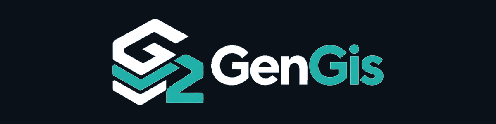
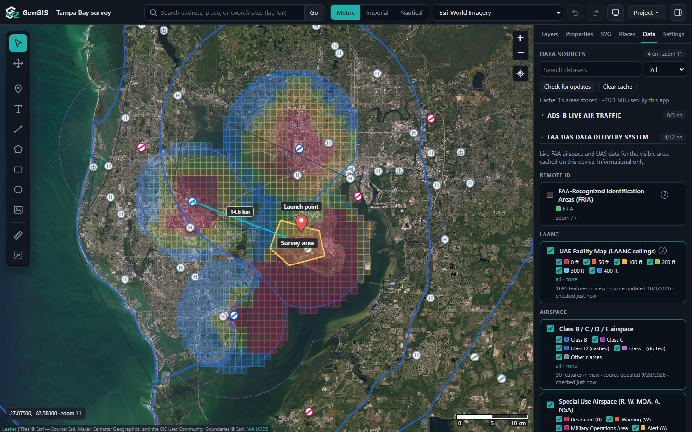
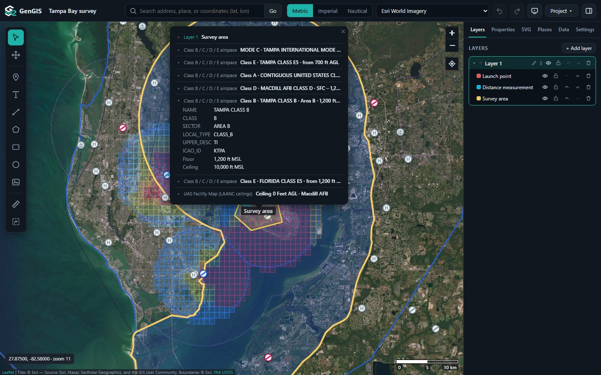
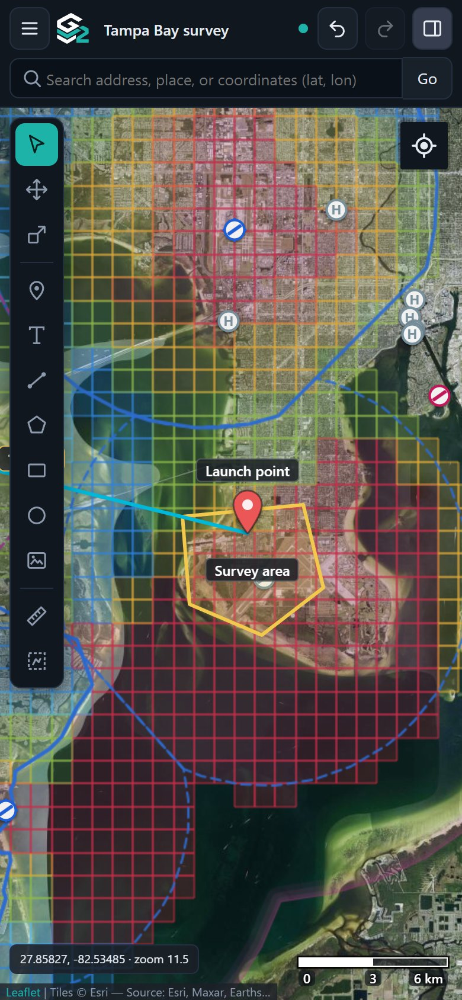
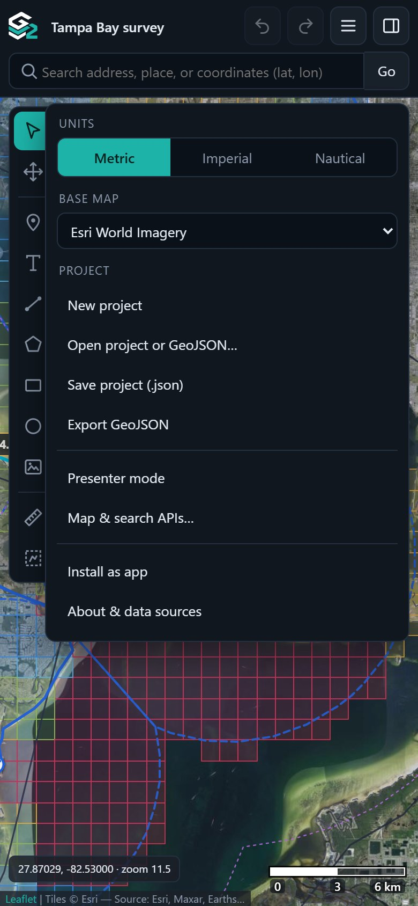
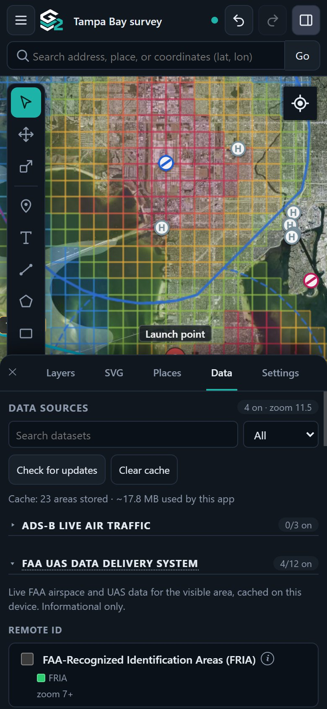

# 🗺️ [GenGIS (G²)](https://g2.luiscintron.com)

[](https://g2.luiscintron.com)
[](https://github.com/lcintron/gengis/releases/latest)
[](https://leafletjs.com/)
[](https://github.com/lcintron/gengis/releases/latest)



A free map builder that runs in the browser (installable, works offline) or as a desktop app ([installers](https://github.com/lcintron/gengis/releases/latest) for Windows, macOS and Linux). Draw and measure on the map, organize your work in layers, and overlay live FAA airspace, LAANC ceilings and air traffic. No account or API key needed.





<p align="center">
  
  
  
</p>

## Features

- **Draw and edit** markers, text, lines, polygons, circles and preset shapes (rectangle, triangle, pentagon, hexagon, octagon, star, lightning bolt), with snapping, name labels and full styling (fill colour, opacity and a pattern: diagonal, cross-hatch, grid or dots). By default, each new object gets its own color. Texts take a font, a background opacity and an editable shadow.
- **Move and resize**: the Move tool drags objects and shows a box around what it moves; the Scale tool resizes from any corner or side (Shift keeps proportions, Alt resizes from the center).
- **Images**: place SVGs (scaled with the map or a fixed size on screen) and pictures (PNG, JPEG, WebP, GIF, kept to scale on the ground) from the Images panel.
- **Icons**: pick from 1,600+ open-source [Lucide](https://lucide.dev) icons (search by name or tag, any color, an optional dark outline for imagery) and place them like any image.
- **Combine and reuse**: multi-select, join lines into shapes, join overlapping shapes into one polygon, duplicate, and copy a style to paste on other objects.
- **Measure** distances and areas in metric, imperial or nautical units, with a scale bar. A circle shows its radius while you draw it, and objects can show their length, perimeter, area, radius or position on the map.
- **Layers** with show/hide, lock and draw order, duplicate, and **groups**: a grouped layer's objects are selected, moved, resized and deleted together. Locked objects can still be selected and inspected. Undo/redo, right-click menus, presenter mode with full screen. Cast to a screen (project menu) mirrors the map on a TV in presenter mode. The toolbar sits on the left or the right of the map (Settings → Interface).
- **Projects** save automatically on the device as you work, with recent projects and earlier copies to restore; save/open as `.gengis.json`; GeoJSON import/export; the map exported as a PNG, JPEG or PDF (up to 4× resolution, paper size and margins). In the desktop app each named project is also kept as a file (`Documents\GenGIS` by default).
- **Cloud sync** (web app): keep named projects in your own OneDrive (personal, or Microsoft 365 work or school) and open them on your other devices. Changes go up a few seconds after you make them and come down when another device changes them; a project edited in two places is never overwritten: you choose. No GenGIS server: files go straight between your device and your account (`OneDrive/Apps/GenGIS`).
- **Annotations**: draw freehand on the map with a stylus, or Shift + drag with a mouse or touchpad (pen or highlighter, color and width; an eraser in four sizes, or the stylus's own eraser end), into an Annotations layer; fingers and the mouse keep moving the map.
- **More base maps, the ATAK way**: import MOBAC map sources (one .xml, or a .zip of many, such as the [ATAK-Maps](https://github.com/joshuafuller/ATAK-Maps) set): tile servers (including Bing quadkeys and rotating servers), WMS layers (EPSG:3857 or 4326) and blended multi-layer maps. They join the base map list, grouped by folder; sources that need an API key say so.
- **Search** addresses, places and coordinates; find points of interest; center on **your location**, with a beam showing which way the device points (compass, or direction of travel).
- **FAA data**, live for the area in view: Class B–E airspace with floors and ceilings, special use airspace, LAANC ceilings, security flight restrictions, TFRs, airports (with radio frequencies) and more. Click anywhere to see everything under that point; the feature's source, geometry and attributes show in Properties. Country and state borders at every zoom. Any public ArcGIS layer can be added.
- **Live air traffic (ADS-B)** from your own receiver (dump1090-fa / SkyAware, dump1090-mutability, readsb, tar1090, or the original dump1090's built-in server; GenGIS finds the data path and remembers it for that address) or the adsb.fi and adsb.lol networks, with type icons colored by altitude and aircraft look-up.
- **Live vessel traffic (AIS)** from your own AIS-catcher receiver or the aisstream.io network, colored by ship type, with vessel details.
- **Live drones (MAVLink)** from a [mavp2p](https://github.com/bluenviron/mavp2p) server: every vehicle it relays, by type, orange when armed, with its trail and home. Click one for its flight mode (ArduPilot and PX4), altitude, speed, battery, GPS and latest message. Read only: GenGIS never sends a vehicle a command. Live traffic always draws above your own objects, so a click on it opens its details.
- **Grids and coordinates**: optional latitude/longitude and MGRS grids (Settings → Grid systems) that get finer as you zoom in, labelled along the edges or the center lines; coordinates shown in decimal degrees, degrees and minutes, or degrees, minutes and seconds. Search any MGRS reference (a grid zone down to 1 m) to center on its square.
- **Magnetic declination** from the World Magnetic Model (WMM2025), computed on the device: isogonic lines on the map, and a click anywhere gives the declination and heading correction there.
- **Place names**: countries, major cities, and oceans and seas, each toggled in Settings next to the borders.
- **Base maps**: Esri World Imagery (default), OpenStreetMap, OpenTopoMap, CyclOSM, CARTO, plus your own XYZ/WMS or keyed providers. Zoom in quarter steps.
- **Offline**: download map tiles and data for an area ahead of time.

Informational only: not for navigation or flight authorization.

## Run it yourself

```bash
node serve.js 8080      # web app at http://localhost:8080
npm install && npm start  # desktop app (Electron)
```

Any static web server works for the web app. Open it with a location: `?q=Eiffel+Tower`, `?lat=48.858&lon=2.294&zoom=16` or `?poi=cafe`.

### Live air and vessel traffic: where it works

Browsers only read another server's data when it allows them to (CORS), and block plain-HTTP requests from an HTTPS page. The desktop app has neither limit.

| Source | Desktop app | Web app over `http://` | Web app over HTTPS |
| --- | --- | --- | --- |
| dump1090 that sends CORS headers (dump1090-fa, tar1090) | yes | yes | only on `localhost` or over HTTPS |
| dump1090 without CORS headers | yes | no | no |
| adsb.fi, adsb.lol | yes | no | no |
| AIS-catcher (web viewer on, `-N 8100`) | yes | yes | only on `localhost` or over HTTPS |
| aisstream.io (free API key) | yes | no | no |

### Live drones (MAVLink): connecting to mavp2p

Data → MAVLink live drones: choose how to connect and enter the address of the computer running mavp2p. A web page cannot open TCP or UDP connections, so the web app connects through a WebSocket bridge; the desktop app connects directly.

| Connect | mavp2p endpoint | Address in GenGIS | Works in |
| --- | --- | --- | --- |
| TCP | `tcps:0.0.0.0:5760` | `192.168.1.20` (port 5760) | desktop app |
| UDP | `udps:0.0.0.0:14550` | `192.168.1.20` (port 14550) | desktop app |
| UDP, listen here | `udpc:<this computer>:14550` | `14550` | desktop app |
| WebSocket | `tcps:0.0.0.0:5760`, plus `websockify 5761 localhost:5760` | `192.168.1.20:5761` | desktop app, and the web app over `http://` (over HTTPS: `wss://`, or on `localhost`) |

For example `mavp2p serial:/dev/ttyUSB0:57600 tcps:0.0.0.0:5760`. Over UDP to a server, GenGIS sends a keepalive once a second so the server keeps sending (not a ground station's heartbeat). mavp2p asks ArduPilot vehicles for their telemetry itself, unless started with `--streamreq-disable`.

### Cloud sync: setting up OneDrive (once, for whoever hosts GenGIS)

Cloud sync stays hidden until the app has a Microsoft Entra app registration:

1. [entra.microsoft.com](https://entra.microsoft.com) → App registrations → New registration: name **GenGIS**, supported accounts **any Entra ID tenant and personal Microsoft accounts**.
2. Authentication → Add a platform → **Single-page application**, redirect URIs `https://g2.luiscintron.com/` and `http://localhost:8080/`. Leave implicit grant off; no client secret.
3. API permissions → Microsoft Graph, delegated: `Files.ReadWrite.AppFolder`, `offline_access`, `openid`, `profile`, `email`. Don't grant admin consent: users consent for themselves.
4. Branding: name, logo, home page and privacy page on your domain, then **publisher verification** (a free Microsoft partner ID), which lets more Microsoft 365 organizations allow the app.
5. Put the Application (client) ID in `CLIENT_ID` in `js/cloud-onedrive.js`.

To try it locally first: `localStorage.setItem('gengis.dev.onedriveClientId', '<client id>')` on `http://localhost:8080`. In a web browser Microsoft keeps a sign-in for 24 hours; GenGIS renews it on start-up, usually without asking.

## Tests

`npm test` runs the automated tests (no installs): cloud sync's sign-in, the OneDrive adapter, the sync engine, and load, stress, chaos and performance runs against a fake Microsoft. They run on every pull request.

## Releasing

Releases run in CI on demand: **Actions → Release → Run workflow** on `main` (or `gh workflow run release.yml -f bump=auto`). By default, the version bump is derived from conventional commits (or choose one in the form). The workflow tags the release, builds Windows, macOS and Linux installers, publishes a GitHub Release, and deploys the site. **Dry run** only reports the version it would release. `make serve`, `make build` and `make release DRY=1` do the same locally.

## Keyboard shortcuts

| Key | Action |
| --- | --- |
| V / G / K | Select / Move / Scale |
| M / T / L / P / R / C / S | Marker, Text, Line, Polygon, Rectangle, Circle, SVG |
| D / A | Measure distance / area |
| F | Presenter mode |
| Esc / Delete | Cancel or deselect / delete |
| Ctrl/Cmd + Z / Y / D / S | Undo / redo / duplicate (a group: its layer) / save |
| / | Search |

## Data sources and fair use

Map tiles, [Nominatim](https://operations.osmfoundation.org/policies/nominatim/) search and the [Overpass API](https://wiki.openstreetmap.org/wiki/Overpass_API) are free public services with their own usage policies; attribution is shown on the map. FAA data comes from the [FAA UAS Data Delivery System](https://udds-faa.opendata.arcgis.com/), borders from the [Esri Living Atlas](https://livingatlas.arcgis.com/), magnetic declination from NOAA's [World Magnetic Model](https://www.ncei.noaa.gov/products/world-magnetic-model) (public domain), and place names from [Natural Earth](https://www.naturalearthdata.com/) (public domain; rebuilt with `node scripts/build-places.js`). Air traffic from [adsb.fi](https://github.com/adsbfi/opendata) is for personal, non-commercial use and [adsb.lol](https://adsb.lol) is ODbL; the app polls no faster than each allows. Vessel traffic from [aisstream.io](https://aisstream.io) needs your own free key, kept on your device only. For heavy use, point the app at your own servers (Project → Map & search APIs).

## License

GenGIS is **free for noncommercial use** under the [PolyForm Strict License 1.0.0](LICENSE): personal use, hobby projects, study and research, and use by noncommercial organizations such as charities, schools, public research, public safety, health, environmental protection and government organizations (see the license for the exact terms).

**Commercial use, changes and redistribution need a commercial license.** Get in touch through [github.com/lcintron](https://github.com/lcintron).

Versions up to and including 0.16.2 were released under the MIT License and stay available under it. Bundled Leaflet (BSD 2-Clause), Leaflet-Geoman (MIT), polygon-clipping (MIT), html-to-image (MIT) and the Lucide icons (ISC) keep their own licenses. Live data services (map tiles, search, air and vessel traffic) have their own terms of use, which apply to whoever uses them.
